<a href="https://lithikajmalothu-16.github.io/">Portfolio</a> · <a href="https://www.linkedin.com/in/lithika-jadav-malothu-a890a1211">LinkedIn</a> · <a href="https://medium.com/@lithikajadav">Medium</a> · <a href="mailto:lithikajadav16@gmail.com">Email</a>

<b>Project links & details</b>

 

| Project | What it does | Stack |
|:--|:--|:--|
| [**Battery Arbitrage Optimizer**](https://github.com/lithikajmalothu-16/battery-arbitrage-optimizer) | Forecasts day-ahead prices and plans when a battery charges and discharges. | `Python · LightGBM · PuLP` |
| [**CarbonTrace**](https://github.com/lithikajmalothu-16/carbontrace) | Agentic Azure pipeline that validates Scope 3 supplier emissions for audit. | `Azure AI · LangGraph · Python` |
| [**FinOps Cost Allocation**](https://github.com/lithikajmalothu-16/finops-cost-allocation) | Splits shared Azure costs by usage and flags spending anomalies with KQL. | `Azure · KQL · Power BI` |
| [**Power BI Sales Analysis**](https://github.com/lithikajmalothu-16/choco-analysis-powerbi) | Raw spreadsheets turned into a star schema, DAX measures, and a dashboard. | `Power BI · DAX · Power Query` |

📚 Studying for PL-300 · AZ-900 · AI-901 &nbsp;·&nbsp; 
